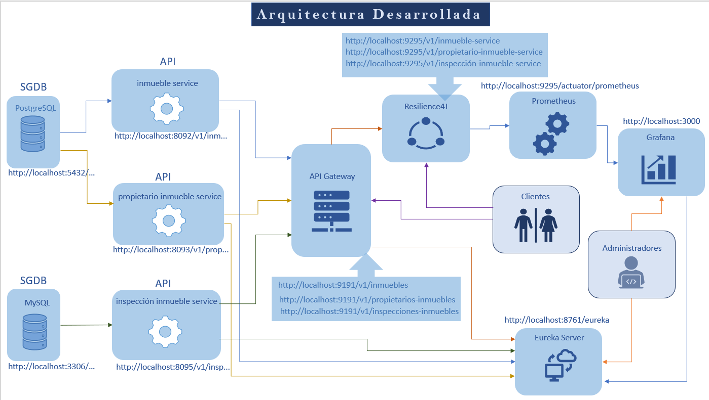
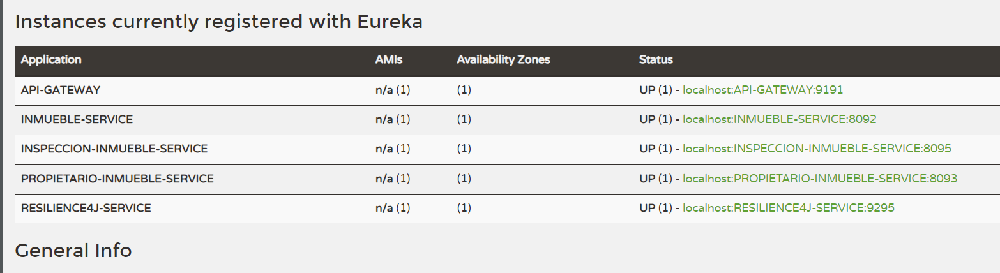
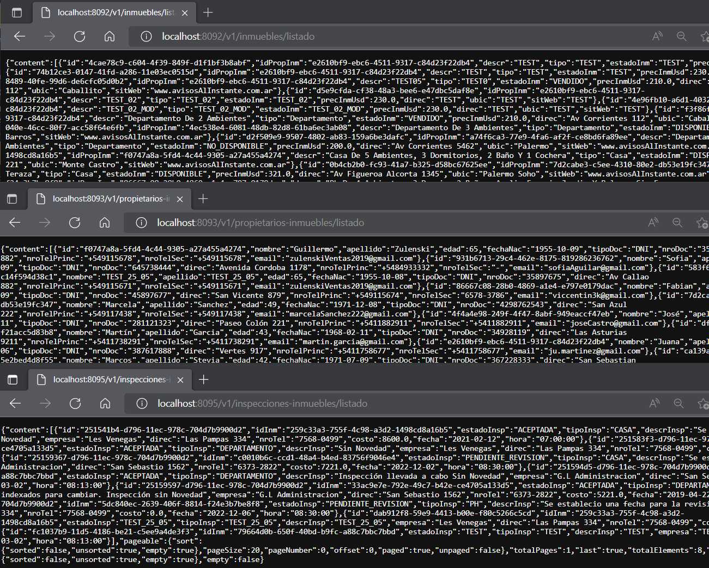
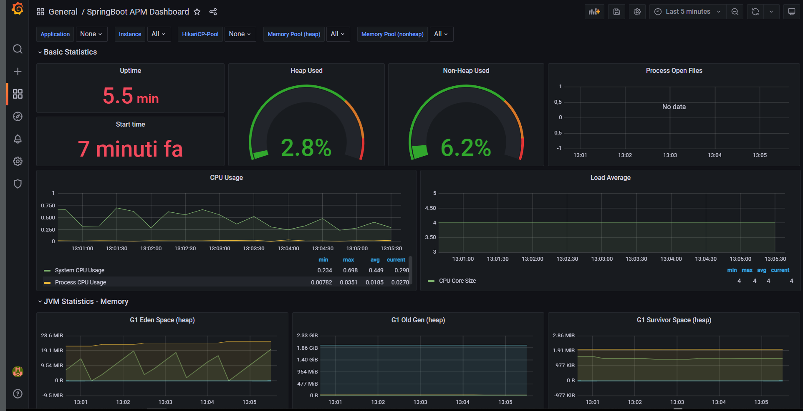
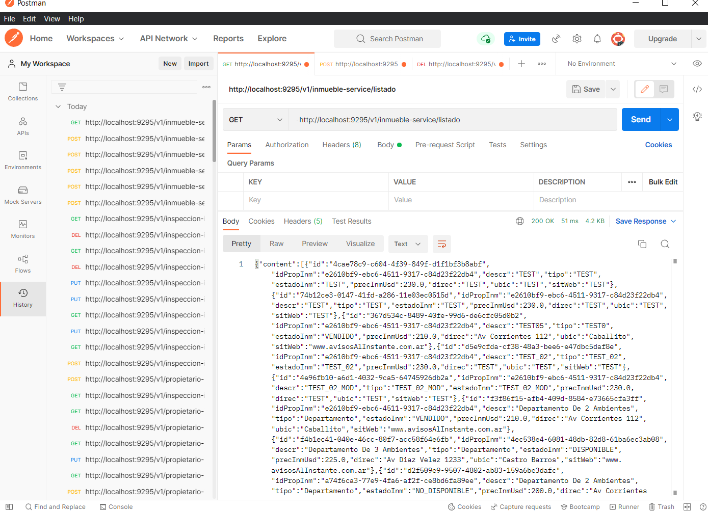
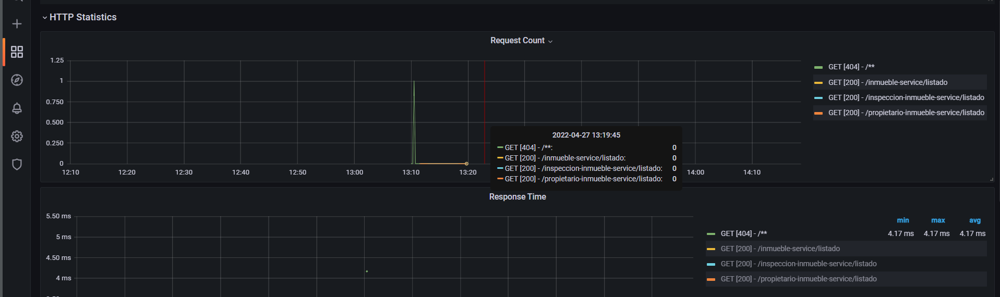
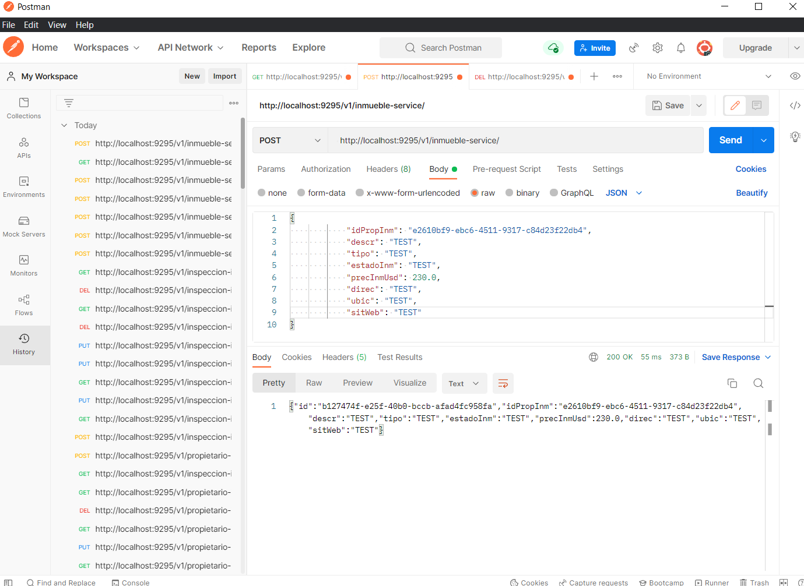
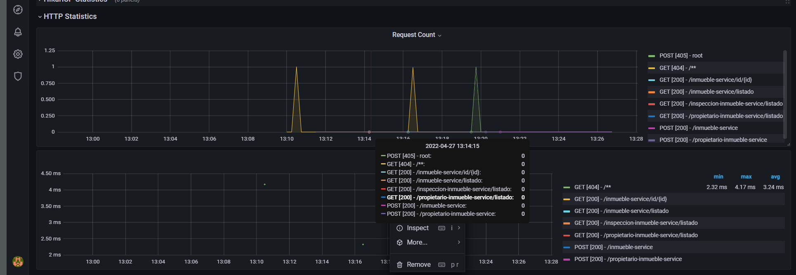
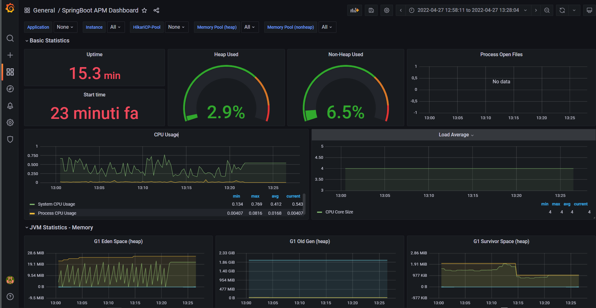
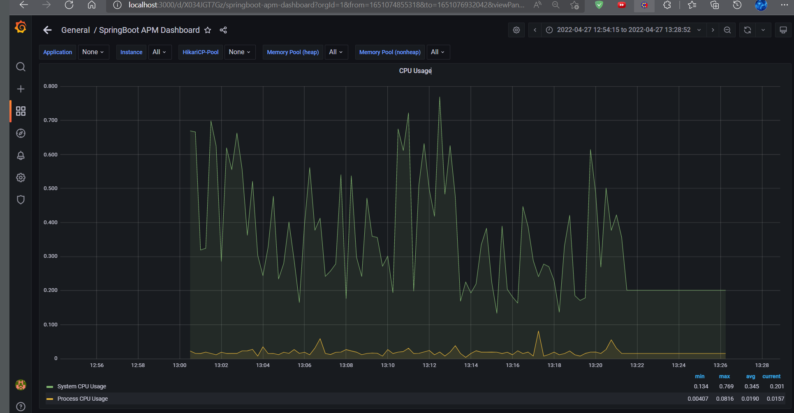

<div align="center">
  
</div>

  <div align="right">
    
    
    
    
	 
	  
    
     
     
	 
	  
	
	   
  </div>

<br>

<br>


<div align="right"> 
  <a href="./README.es.md">
    
  </a> 
  <a href="../../README.md">
    
  </a> 
</div>

<br>

<br>

<div align="center">

# Microservicios Inmobiliaria 

</div>

Implementación de Microservicios para inmobiliaria con Spring Boot, Spring Cloud, Spring Data JPA, Resilience4J, Grafana, Prometheus, Lombok, Maven, Postman, Api Restful, Postgres, Mysql y otras Tecnologías.

<br>

* [Repositorio db inmobiliaria postgres](https://github.com/andresWeitzel/db_inmobiliaria_microservicios_postgres)
* [Repositorio db inspecciones inmuebles mysql](https://github.com/andresWeitzel/db_inspecciones_inmuebles_microservicios_mysql)
* [Functional Playlist](https://www.youtube.com/playlist?list=PLCl11UFjHurC0zJPiNF-rCbAFd2BGUBOe) <a href="https://www.youtube.com/playlist?list=PLCl11UFjHurC0zJPiNF-rCbAFd2BGUBOe" target="_blank"> </a>
 


<br>

## Índice 📜

<details>
 <summary> Ver detalles </summary>
 
<div align="right">

`Última actualización: 19/02/26` 

</div>

 
 
### Sección 1) Descripción, Tecnologías y Dependencias 
 
 - [1.0) Descripción del Proyecto.](#10-descripción-)
 - [1.1) Patrones de Diseño.](#11-patrones-de-diseño-)
 - [1.2) Tecnologías.](#12-tecnologías-)
     - [1.2.1) Descargas.](#121-descargas)
 - [1.3) Dependencias Maven.](#13-dependencias-maven-)
 
### Sección 2) Endpoints y Recursos 
 
 - [2.0) EndPoints.](#endpoints-)
 - [2.1) Recursos por Endpoints.](#documentación-gráfica-de-recursos-por-endpoints-swagger-ui-)
 - [2.2) Ejemplos de Requests y Responses.](#22-ejemplos-de-requests-y-responses-)
 
 
### Sección 3) Prueba de Funcionalidad y Referencias
 
 - [3.0) Prueba de Funcionalidad.](#30-prueba-de-funcionalidad-)
 - [3.1) Referencias.](#31-referencias-)
	
### Sección 4) Creación y Configuración del Modelo de Microservicio InmuebleService desde cero
 
 - [4.0) Modelo de Microservicio InmuebleService.](#40-modelo-de-microservicio-inmuebleservice-)
     - [4.0.0) Creación y Configuración.](#400-creción-y-configuración)
     - [4.0.1) Enums.](#401-enums)
     - [4.0.2) Entidades.](#402-entidades)
     - [4.0.3) Interfaces.](#403-interfaces)
     - [4.0.4) Servicios.](#404-servicios)
     - [4.0.5) Objetos Value Object.](#405-objetos-value-objects)
     - [4.0.6) Template Value Object.](#406-template-value-objects)
     - [4.0.7) Controllers.](#407-controllers)
- [4.1) Configuración de la db.](#41-configuración-de-la-db-)
- [4.2) Configuración del application.properties.](#42-configuración-del-application-properties)
- [4.3) Manejo de Postgres desde cmd.](#43-manejo-de-postgres-desde-cmd)
- [4.4) Prueba de funcionalidad.](#44-prueba-de-funcionalidad)

### Sección 5) Uso y manejo de Git

- [5.0) Descarga.](#50-descarga-)
- [5.1) Subir proyecto al repositorio remoto.](#51-subir-proyecto-al-repositorio-remoto-)
- [5.2) Actualización del repositorio del proyecto.](#52-actualización-del-repositorio-del-proyecto-)
 
	
	
</details>


<br>

## Sección 1) Descripción, Tecnologías y Dependencias 


### 1.0) Descripción [🔝](#índice-) 

<details>
 <summary>Ver detalles</summary>
 
 <br>

* Este proyecto surgió a fin de poner en práctica la interrelación y funcionamiento de varios Microservicios con diferentes SGDB como lo son Mysql y Postgres.
* Los Microservicios `PropietarioInmuebleService` e `InmuebleService` implementan una misma base de datos de tipo SGDB Postgres para una inmobiliaria.
* El Microservicio `InspeccionInmuebleService` se comunicará con una base de datos de tipo Mysql para la validación y control de los inmuebles de dicha.
* El Servicio de Gestión Genérico de los Microservicios será `EurekaService`, este no implementará ninguna base de datos ya que será el responsable de toda la gestión y Control del resto de los Microservicios y Servicios.
* El Servicio `Api Gateway` será el encargado de la gestión del resto de los 3 microservicios de la aplicación, se entrelaza mediante el Patrón de Diseño Circuit Breaker para el Control de Excepciones, Tolerancias a fallos, etc. Todos los recursos de los microservicios pasan a través del puerto y dirección de este.
* El Servicio `ResilienceFourJ` será el encargado de manejar de forma directa el Control de Excepciones, Errores, etc que se puedan presentar, al igual que el ApiGateway maneja el patrón Circuit Breaker, además para cada recurso de cada microservicio se implementar los módulos de dicho patrón.
* ResilienceFourJ está directamente configurado para trabajar con `Prometheus` y `Grafana`. Prometheus Manejará toda la información de ResilienceFourJ y Grafana deployará dicha información en un entorno Gráfico de tipo Dashboard.


* El Proyecto consta de 3 microservicios de tipo REST y 3 servicios de gestión, administración y seguridad para los microservicios

``` Microservicios
|  |  |--------> Microservice Rest InmuebleService ----------------> db_inmobiliaria_microservicios  		--> (Postgres) --> (compartida) 
|  |-----------> Microservice Rest PropietarioInmuebleService------> db_inmobiliaria_microservicios  		--> (Postgres) --> (compartida) 
|--------------> Microservice Rest InspeccionInmuebleService-------> db_inspecciones_inmuebles_microservicios   --> (Mysql)    --> (única)  
```

```
Servicios
|  |  |  |-----> Servicio EurekaService -----------> Servidor de Gestión de Microservicios
|  |  |--------> Servicio ApiGatewayService -------> Proxy con balanceo de carga para la gestión de peticiones de los Microservicios 
|  |-----------> Servicio ResilienceFourJService --> Servicio para el Control de Excepciones y Tolerancia a Fallos. Patrón Circuit Breaker
| |------------> Servicio Prometheus/Actuator -----> Manejo de los datos de ResilienceFourJ
|--------------> Servicio Grafana Dashboard -------> Deploy de los datos transferidos por Prometheus
```
 
 <br>

* [Repositorio db inmobiliaria postgres](https://github.com/andresWeitzel/db_inmobiliaria_microservicios_postgres)
* [Repositorio db inspecciones inmuebles mysql](https://github.com/andresWeitzel/db_inspecciones_inmuebles_microservicios_mysql)
* [PlayList Proyecto](https://www.youtube.com/playlist?list=PLCl11UFjHurC0zJPiNF-rCbAFd2BGUBOe)
 
<br>

</details>


### 1.1) Patrones de Diseño [🔝](#índice-)

<details>
 <summary>Ver detalles</summary>
 
 <br>

| **Patrón de Diseño** | **Finalidad** |               
| ------------- | ------------- |
| DAO | Uso de interfaces y repositorios para la persistencia y almacenamiento de datos. |
| MVC | Separación y Representación de los Datos, Manejo de errores, Escalabilidad, etc  |
| VO  | Patrón Value Object para el relacionamiento de Objetos a través de Templates de cada Microservicio |
| DTO  | Patrón para el Uso de Objetos POJO para tranferencia de datos entre los Microservices y Resilience4J |
| Circuit Breaker | Patrón para el Control y Manejo de Excepciones junto con la Tolerancia a Fallos |

<br>

</details>


### 1.2) Tecnologías [🔝](#índice-)

<details>
 <summary>Ver detalles</summary>
 
 <br>

| **Tecnologías** | **Versión** | **Finalidad** |           
| ------------- | ------------- | ------------- |
| [Java](https://docs.oracle.com/en/) |  12.0.2 | JDK |
| [Spring Tool Suite 4](https://spring.io/blog/2021/06/21/spring-tools-4-11-0-released) | 4.9.0  | IDE |
| [Spring Boot](https://spring.io/) |  2.6.4  | Framework |
| [Spring Boot Data JPA](https://spring.io/projects/spring-data-jpa)  | 2.6.3 | Mapeo de objetos y persistencia en la db |
| [Spring Validation](https://www.baeldung.com/spring-boot-bean-validation)  | 2.7 | Anotations para Validaciones |
| [Eureka Server and Client](https://cloud.spring.io/spring-cloud-netflix/multi/multi_spring-cloud-eureka-server.html) | 3.1.1 | Administración de Microservicios |
| [Api-Gateway](https://www.baeldung.com/spring-cloud-gateway) | 3.1.1 | Manejo de Recursos de nuestro Proxy |
| [Resilience4J](https://resilience4j.readme.io/docs) | 3.1.1 | Utilización del Patrón Circuit Breaker |
| [Spring-Actuator](https://resilience4j.readme.io/docs) | 3.1.1 | Monitorización y Administraciíon ApiRest |
| [Micrometer-Prometheus](https://www.baeldung.com/micrometer) | 1.8.4 | Dashboard y Monitorizacion data |
| [Prometheus App](https://prometheus.io/) | 2.35 |  Monitoreo |
| [Grafana App](https://grafana.com/) | 8.4.6 | Deploy de Analítica Microservicios |
| [Lombok](https://projectlombok.org/) | 1.18.22 | Automatización de Código | 
| [Open-Api y UI Swagger](https://www.openapis.org/) | 1.6.4 | Documentación de la Api | 
| [UI Swagger](https://swagger.io/tools/swagger-ui/) | 1.6.4 | Visualización y Gestión de la Api | 
| [Maven](https://maven.apache.org/) |  4.0.0 | Gestor de Proyectos |
| [Postman](https://www.postman.com/) | 9.1.1 | Visualización y Gestión de la Api | 
| [XAMPP](https://www.apachefriends.org/https://www.apachefriends.org/) | 3.2.2  | Paquete de Servidores |
| [DBeaver](https://www.apachefriends.org/) | 21.1 | Gestor de Base de Datos |
| [Mysql](https://www.mysql.com/) | 10.1.38 | Sistema de Gestión de Bases de Datos |
| [PostgreSQL](https://www.postgresql.org/) | 13.4 | Sistema de Gestión de Bases de Datos |
| [CMD](https://learn.microsoft.com/en-us/windows-server/administration/windows-commands/cmd) | 10 | Símbolo del Sistema para linea de comandos | 
| [GNU bash / Terminal](https://www.gnu.org/software/bash/) | 4.4.23  | Bash / Terminal para el manejo e implementación de Git. |
| [Git](https://git-scm.com/) | 2.29.1  | Control de Versiones |

<br>

</details>


### 1.2.1) Descargas [🔝](#índice-)

<details>
 <summary>Ver detalles</summary>
 
 <br>

* [Java-JDK 12](https://www.oracle.com/java/technologies/javase/jdk12-archive-downloads.html)
* [Spring Tool Suite 4](https://spring.io/tools)
* [Prometheus](https://prometheus.io/download/)
* [Grafana](https://grafana.com/grafana/download?platform=windows)
* [Dbeaver](https://dbeaver.io/download/)
* [PostgreSQL](https://www.postgresql.org/download/)
* [MySQL](https://www.mysql.com/it/)	
* [Xampp](https://www.apachefriends.org/download.html)
* [Lombok](https://projectlombok.org/download)
* [Open UI](https://open-ui.org/)
* [Postman](https://www.postman.com/downloads/)
* [MongoDB](https://www.mongodb.com/try/download/community)
* [MongoDB Compass](https://www.mongodb.com/try/download/compass)
* [Git](https://git-scm.com/downloads)

<br>

</details>


### 1.3) Dependencias Maven [🔝](#índice-)

<details>
 <summary>Ver detalles</summary>
 
 <br>

| **Dependencia Maven**  | **Versión** | **Finalidad** |             
| ------------- | ------------- | ------------- |
| mysql-connector | 8.0.21 |  Conexión al SGDB Mysql |
| postgresql-connector | 42.3.1 | Conexión al SGDB PostgreSQL | 
| lombok | 1.18.22 |  Dependencia para la automatización de Código |
| spring-boot-starter-test | 2.6.4 | Uso de Testing |
| spring-boot-starter-data-jpa | 2.6.4 | Api de JpaRepository para el manejo de métodos | 
| spring-boot-starter-devtools | 2.6.6 | Herramienta para la recompilación en tiempo de ejecución |
| spring-boot-starter-web | 2.6.4 | Se agrega toda la configuración web automáticamente de Maven a Spring |
| spring-boot-starter-actuator | 2.6.6 | Monitorización y Administración de la Api Rest |
| spring-boot-starter-aop | 2.6.6 | Modularidad de la Api Rest |
| spring-cloud-starter-netflix-eureka-client | 3.1.1 | Conexión de Servicio con el Servidor Eureka |
| spring-cloud-starter-netflix-eureka-server | 3.1.1 | Dependencias para el Servidor Eureka |
| spring-cloud-starter-gateway | 3.1.1 | Manejo de Recursos de nuestro Proxy |
| spring-cloud-starter-bootstrap | 3.1.1 | Preparación del Servidor de Configuración |
| spring-cloud-starter-config | 3.1.1 | Nos permite exteriorizar y centralizar la configuración de los microservicios en un solo lugar |
| spring-cloud-starter-circuitbreaker-resilience4j | 2.1.1 | Dependencia para el patrón Circ Break y el uso de Resiliencia | 

| **Administrador de Dependencia Maven**  | **Versión** | **Finalidad** |             
| ------------- | ------------- | ------------- |
| spring-cloud-dependencies | 2021.0.0 | Administrador de Dependencias cloud |


<br>

</details>


<br>

## Sección 2) EndPoints y Recursos

### 2.0) EndPoints [🔝](#índice-)

<details>
 <summary>Ver detalles</summary>
 
### EndPoints MicroServicios Por Defecto:
* http://localhost:8092/v1/inmuebles/
* http://localhost:8093/v1/propietarios-inmuebles/
* http://localhost:8095/v1/inspecciones-inmuebles/

### EndPoints MicroServicios con Api Gateway:
* http://localhost:9191/v1/inmuebles/
* http://localhost:9191/v1/propietarios-inmuebles/
* http://localhost:9191/v1/inspecciones-inmuebles/

### EndPoints MicroServicios con Resilience4J
* http://localhost:9295/v1/inmueble-service
* http://localhost:9295/v1/propietario-inmueble-service/
* http://localhost:9295/v1/inspeccion-inmueble-service/

### EndPoint Analítica con Prometheus
* http://localhost:9295/actuator/prometheus

### EndPoint Deploy con Grafana (username:admin password:admin)
* http://localhost:3000/d/X034JGT7Gz/springboot-apm-dashboard?orgId=1&from=now-1m&to=now
  

<br>

</details>


### 2.1) Recursos por Endpoints. (Swagger UI) [🔝](#índice-)

<details>
 <summary>Ver detalles</summary>

### Servicios en Spring Cloud Eureka Server


### MicroServices por host y puerto independientes


### Deploy de Carga Inicial de Recursos a través de Grafana


### Métodos GET Testeo Microservices puerto Resilience con Postman


### Estadisticas de uso Http Métodos GET en Grafana


### Métodos POST Testeo Microservices puerto Resilience con Postman


### Estadisticas de uso Http Métodos POST en Grafana


### Deploy de Carga luego del consumo de Recursos a través de Grafana

	
### Deploy de Carga de CPU Usada por el Sistema luego del consumo de Recursos a través de Grafana


 
 <br>

</details>

### 2.2) Ejemplos de Requests y Responses [🔝](#índice-)

<details>
 <summary>Ver detalles</summary>

## Microservicio InmuebleService

### 2.2.1) POST Operations

#### Create Inmueble

###### Request (POST)

**Method:** POST  
**URL:** `http://localhost:8092/v1/inmuebles/`  
**Headers:**  
- Content-Type: application/json

**Body (raw JSON):**
```json
{
    "idPropInm": "550e8400-e29b-41d4-a716-446655440000",
    "descr": "Departamento de 2 ambientes con balcón",
    "tipo": "Departamento",
    "estadoInm": "DISPONIBLE",
    "precInmUsd": 150000.0,
    "direc": "Av. Corrientes 1234",
    "ubic": "Palermo",
    "sitWeb": "www.inmobiliaria.com"
}
```

###### Response (200 OK)

```json
{
    "id": "550e8400-e29b-41d4-a716-446655440001",
    "idPropInm": "550e8400-e29b-41d4-a716-446655440000",
    "descr": "Departamento de 2 ambientes con balcón",
    "tipo": "Departamento",
    "estadoInm": "DISPONIBLE",
    "precInmUsd": 150000.0,
    "direc": "Av. Corrientes 1234",
    "ubic": "Palermo",
    "sitWeb": "www.inmobiliaria.com"
}
```

###### Response (422 Unprocessable Entity)

```json
{
    "message": "No se ha Insertado el Inmueble en la Base de Datos"
}
```

### 2.2.2) GET Operations

#### Get All Inmuebles (Paginated)

###### Request (GET)

**Method:** GET  
**URL:** `http://localhost:8092/v1/inmuebles/listado?page=0&size=5&sort=id,desc`  
**Headers:**  
- Content-Type: application/json

###### Response (200 OK)

```json
{
    "content": [
        {
            "id": "550e8400-e29b-41d4-a716-446655440001",
            "idPropInm": "550e8400-e29b-41d4-a716-446655440000",
            "descr": "Departamento de 2 ambientes con balcón",
            "tipo": "Departamento",
            "estadoInm": "DISPONIBLE",
            "precInmUsd": 150000.0,
            "direc": "Av. Corrientes 1234",
            "ubic": "Palermo",
            "sitWeb": "www.inmobiliaria.com"
        }
    ],
    "pageable": {
        "sort": {
            "sorted": true,
            "unsorted": false
        },
        "pageNumber": 0,
        "pageSize": 5,
        "offset": 0,
        "paged": true,
        "unpaged": false
    },
    "totalElements": 1,
    "totalPages": 1,
    "last": true,
    "first": true,
    "sort": {
        "sorted": true,
        "unsorted": false
    },
    "numberOfElements": 1,
    "size": 5,
    "number": 0
}
```

#### Get Inmueble by ID

###### Request (GET)

**Method:** GET  
**URL:** `http://localhost:8092/v1/inmuebles/id/550e8400-e29b-41d4-a716-446655440001`  
**Headers:**  
- Content-Type: application/json

###### Response (200 OK)

```json
{
    "id": "550e8400-e29b-41d4-a716-446655440001",
    "idPropInm": "550e8400-e29b-41d4-a716-446655440000",
    "descr": "Departamento de 2 ambientes con balcón",
    "tipo": "Departamento",
    "estadoInm": "DISPONIBLE",
    "precInmUsd": 150000.0,
    "direc": "Av. Corrientes 1234",
    "ubic": "Palermo",
    "sitWeb": "www.inmobiliaria.com"
}
```

#### Get Inmuebles by Propietario ID

###### Request (GET)

**Method:** GET  
**URL:** `http://localhost:8092/v1/inmuebles/id-propietario-inmueble/550e8400-e29b-41d4-a716-446655440000?page=0&size=10`  
**Headers:**  
- Content-Type: application/json

###### Response (200 OK)

```json
{
    "content": [
        {
            "id": "550e8400-e29b-41d4-a716-446655440001",
            "idPropInm": "550e8400-e29b-41d4-a716-446655440000",
            "descr": "Departamento de 2 ambientes con balcón",
            "tipo": "Departamento",
            "estadoInm": "DISPONIBLE",
            "precInmUsd": 150000.0,
            "direc": "Av. Corrientes 1234",
            "ubic": "Palermo",
            "sitWeb": "www.inmobiliaria.com"
        }
    ],
    "totalElements": 1,
    "totalPages": 1
}
```

#### Get Inmueble with Propietario Template

###### Request (GET)

**Method:** GET  
**URL:** `http://localhost:8092/v1/inmuebles/inmueble-con-propietario-inmueble/id-inm/550e8400-e29b-41d4-a716-446655440001`  
**Headers:**  
- Content-Type: application/json

###### Response (200 OK)

```json
{
    "propietarioInmuebleVO": {
        "id": "550e8400-e29b-41d4-a716-446655440000",
        "nombre": "Juan",
        "apellido": "Pérez",
        "edad": 35,
        "fechaNac": "1988-05-15",
        "tipoDoc": "DNI",
        "nroDoc": "12345678",
        "direc": "Av. Libertador 1000",
        "nroTelPrinc": "11-1234-5678",
        "nroTelSec": "11-8765-4321",
        "email": "juan.perez@email.com"
    },
    "inmueble": {
        "id": "550e8400-e29b-41d4-a716-446655440001",
        "idPropInm": "550e8400-e29b-41d4-a716-446655440000",
        "descr": "Departamento de 2 ambientes con balcón",
        "tipo": "Departamento",
        "estadoInm": "DISPONIBLE",
        "precInmUsd": 150000.0,
        "direc": "Av. Corrientes 1234",
        "ubic": "Palermo",
        "sitWeb": "www.inmobiliaria.com"
    }
}
```

### 2.2.3) PUT Operations

#### Update Inmueble

###### Request (PUT)

**Method:** PUT  
**URL:** `http://localhost:8092/v1/inmuebles/`  
**Headers:**  
- Content-Type: application/json

**Body (raw JSON):**
```json
{
    "id": "550e8400-e29b-41d4-a716-446655440001",
    "idPropInm": "550e8400-e29b-41d4-a716-446655440000",
    "descr": "Departamento de 2 ambientes con balcón y terraza",
    "tipo": "Departamento",
    "estadoInm": "VENDIDO",
    "precInmUsd": 160000.0,
    "direc": "Av. Corrientes 1234",
    "ubic": "Palermo",
    "sitWeb": "www.inmobiliaria.com"
}
```

###### Response (200 OK)

```json
{
    "id": "550e8400-e29b-41d4-a716-446655440001",
    "idPropInm": "550e8400-e29b-41d4-a716-446655440000",
    "descr": "Departamento de 2 ambientes con balcón y terraza",
    "tipo": "Departamento",
    "estadoInm": "VENDIDO",
    "precInmUsd": 160000.0,
    "direc": "Av. Corrientes 1234",
    "ubic": "Palermo",
    "sitWeb": "www.inmobiliaria.com"
}
```

### 2.2.4) DELETE Operations

#### Delete Inmueble

###### Request (DELETE)

**Method:** DELETE  
**URL:** `http://localhost:8092/v1/inmuebles/550e8400-e29b-41d4-a716-446655440001`  
**Headers:**  
- Content-Type: application/json

###### Response (200 OK)

```json
{
    "message": "Se ha Eliminado el Inmueble de la Base de Datos"
}
```

---

## Microservicio PropietarioInmuebleService

### 2.2.5) POST Operations

#### Create Propietario Inmueble

###### Request (POST)

**Method:** POST  
**URL:** `http://localhost:8093/v1/propietarios-inmuebles/`  
**Headers:**  
- Content-Type: application/json

**Body (raw JSON):**
```json
{
    "nombre": "María",
    "apellido": "González",
    "edad": 42,
    "fechaNac": "1981-03-20",
    "tipoDoc": "DNI",
    "nroDoc": "87654321",
    "direc": "Av. Santa Fe 2000",
    "nroTelPrinc": "11-9876-5432",
    "nroTelSec": "11-1111-2222",
    "email": "maria.gonzalez@email.com"
}
```

###### Response (200 OK)

```json
{
    "id": "550e8400-e29b-41d4-a716-446655440002",
    "nombre": "María",
    "apellido": "González",
    "edad": 42,
    "fechaNac": "1981-03-20",
    "tipoDoc": "DNI",
    "nroDoc": "87654321",
    "direc": "Av. Santa Fe 2000",
    "nroTelPrinc": "11-9876-5432",
    "nroTelSec": "11-1111-2222",
    "email": "maria.gonzalez@email.com"
}
```

### 2.2.6) GET Operations

#### Get All Propietarios (Paginated)

###### Request (GET)

**Method:** GET  
**URL:** `http://localhost:8093/v1/propietarios-inmuebles/listado?page=0&size=5&sort=apellido,asc`  
**Headers:**  
- Content-Type: application/json

###### Response (200 OK)

```json
{
    "content": [
        {
            "id": "550e8400-e29b-41d4-a716-446655440000",
            "nombre": "Juan",
            "apellido": "Pérez",
            "edad": 35,
            "fechaNac": "1988-05-15",
            "tipoDoc": "DNI",
            "nroDoc": "12345678",
            "direc": "Av. Libertador 1000",
            "nroTelPrinc": "11-1234-5678",
            "nroTelSec": "11-8765-4321",
            "email": "juan.perez@email.com"
        },
        {
            "id": "550e8400-e29b-41d4-a716-446655440002",
            "nombre": "María",
            "apellido": "González",
            "edad": 42,
            "fechaNac": "1981-03-20",
            "tipoDoc": "DNI",
            "nroDoc": "87654321",
            "direc": "Av. Santa Fe 2000",
            "nroTelPrinc": "11-9876-5432",
            "nroTelSec": "11-1111-2222",
            "email": "maria.gonzalez@email.com"
        }
    ],
    "totalElements": 2,
    "totalPages": 1
}
```

#### Get Propietario by ID

###### Request (GET)

**Method:** GET  
**URL:** `http://localhost:8093/v1/propietarios-inmuebles/id/550e8400-e29b-41d4-a716-446655440000`  
**Headers:**  
- Content-Type: application/json

###### Response (200 OK)

```json
{
    "id": "550e8400-e29b-41d4-a716-446655440000",
    "nombre": "Juan",
    "apellido": "Pérez",
    "edad": 35,
    "fechaNac": "1988-05-15",
    "tipoDoc": "DNI",
    "nroDoc": "12345678",
    "direc": "Av. Libertador 1000",
    "nroTelPrinc": "11-1234-5678",
    "nroTelSec": "11-8765-4321",
    "email": "juan.perez@email.com"
}
```

#### Get Propietarios by Nombre

###### Request (GET)

**Method:** GET  
**URL:** `http://localhost:8093/v1/propietarios-inmuebles/nombre/Juan?page=0&size=10`  
**Headers:**  
- Content-Type: application/json

###### Response (200 OK)

```json
{
    "content": [
        {
            "id": "550e8400-e29b-41d4-a716-446655440000",
            "nombre": "Juan",
            "apellido": "Pérez",
            "edad": 35,
            "fechaNac": "1988-05-15",
            "tipoDoc": "DNI",
            "nroDoc": "12345678",
            "direc": "Av. Libertador 1000",
            "nroTelPrinc": "11-1234-5678",
            "nroTelSec": "11-8765-4321",
            "email": "juan.perez@email.com"
        }
    ],
    "totalElements": 1,
    "totalPages": 1
}
```

### 2.2.7) PUT Operations

#### Update Propietario Inmueble

###### Request (PUT)

**Method:** PUT  
**URL:** `http://localhost:8093/v1/propietarios-inmuebles/`  
**Headers:**  
- Content-Type: application/json

**Body (raw JSON):**
```json
{
    "id": "550e8400-e29b-41d4-a716-446655440000",
    "nombre": "Juan Carlos",
    "apellido": "Pérez",
    "edad": 36,
    "fechaNac": "1988-05-15",
    "tipoDoc": "DNI",
    "nroDoc": "12345678",
    "direc": "Av. Libertador 1500",
    "nroTelPrinc": "11-1234-5678",
    "nroTelSec": "11-8765-4321",
    "email": "juan.perez@email.com"
}
```

###### Response (200 OK)

```json
{
    "id": "550e8400-e29b-41d4-a716-446655440000",
    "nombre": "Juan Carlos",
    "apellido": "Pérez",
    "edad": 36,
    "fechaNac": "1988-05-15",
    "tipoDoc": "DNI",
    "nroDoc": "12345678",
    "direc": "Av. Libertador 1500",
    "nroTelPrinc": "11-1234-5678",
    "nroTelSec": "11-8765-4321",
    "email": "juan.perez@email.com"
}
```

### 2.2.8) DELETE Operations

#### Delete Propietario Inmueble

###### Request (DELETE)

**Method:** DELETE  
**URL:** `http://localhost:8093/v1/propietarios-inmuebles/550e8400-e29b-41d4-a716-446655440000`  
**Headers:**  
- Content-Type: application/json

###### Response (200 OK)

```json
{
    "message": "Se ha Eliminado el Propietario del Inmueble de la Base de Datos"
}
```

---

## Microservicio InspeccionInmuebleService

### 2.2.9) POST Operations

#### Create Inspeccion Inmueble

###### Request (POST)

**Method:** POST  
**URL:** `http://localhost:8095/v1/inspecciones-inmuebles/`  
**Headers:**  
- Content-Type: application/json

**Body (raw JSON):**
```json
{
    "idInm": "550e8400-e29b-41d4-a716-446655440001",
    "estadoInsp": "PENDIENTE",
    "tipoInsp": "ESTRUCTURAL",
    "descrInsp": "Inspección estructural completa del edificio",
    "empresa": "Inspecciones S.A.",
    "direc": "Av. Corrientes 1234",
    "nroTel": "11-5555-6666",
    "costo": 500.0,
    "fecha": "2024-01-15",
    "hora": "14:30:00"
}
```

###### Response (200 OK)

```json
{
    "id": "550e8400-e29b-41d4-a716-446655440003",
    "idInm": "550e8400-e29b-41d4-a716-446655440001",
    "estadoInsp": "PENDIENTE",
    "tipoInsp": "ESTRUCTURAL",
    "descrInsp": "Inspección estructural completa del edificio",
    "empresa": "Inspecciones S.A.",
    "direc": "Av. Corrientes 1234",
    "nroTel": "11-5555-6666",
    "costo": 500.0,
    "fecha": "2024-01-15",
    "hora": "14:30:00"
}
```

### 2.2.10) GET Operations

#### Get All Inspecciones (Paginated)

###### Request (GET)

**Method:** GET  
**URL:** `http://localhost:8095/v1/inspecciones-inmuebles/listado?page=0&size=5&sort=fecha,desc`  
**Headers:**  
- Content-Type: application/json

###### Response (200 OK)

```json
{
    "content": [
        {
            "id": "550e8400-e29b-41d4-a716-446655440003",
            "idInm": "550e8400-e29b-41d4-a716-446655440001",
            "estadoInsp": "PENDIENTE",
            "tipoInsp": "ESTRUCTURAL",
            "descrInsp": "Inspección estructural completa del edificio",
            "empresa": "Inspecciones S.A.",
            "direc": "Av. Corrientes 1234",
            "nroTel": "11-5555-6666",
            "costo": 500.0,
            "fecha": "2024-01-15",
            "hora": "14:30:00"
        }
    ],
    "totalElements": 1,
    "totalPages": 1
}
```

#### Get Inspeccion by ID

###### Request (GET)

**Method:** GET  
**URL:** `http://localhost:8095/v1/inspecciones-inmuebles/id/550e8400-e29b-41d4-a716-446655440003`  
**Headers:**  
- Content-Type: application/json

###### Response (200 OK)

```json
{
    "id": "550e8400-e29b-41d4-a716-446655440003",
    "idInm": "550e8400-e29b-41d4-a716-446655440001",
    "estadoInsp": "PENDIENTE",
    "tipoInsp": "ESTRUCTURAL",
    "descrInsp": "Inspección estructural completa del edificio",
    "empresa": "Inspecciones S.A.",
    "direc": "Av. Corrientes 1234",
    "nroTel": "11-5555-6666",
    "costo": 500.0,
    "fecha": "2024-01-15",
    "hora": "14:30:00"
}
```

#### Get Inspeccion with Inmueble Template

###### Request (GET)

**Method:** GET  
**URL:** `http://localhost:8095/v1/inspecciones-inmuebles/inspeccion-inmueble-con-inmueble/id-inmueble/550e8400-e29b-41d4-a716-446655440001`  
**Headers:**  
- Content-Type: application/json

###### Response (200 OK)

```json
{
    "inspeccionInmuebleEntity": {
        "id": "550e8400-e29b-41d4-a716-446655440003",
        "idInm": "550e8400-e29b-41d4-a716-446655440001",
        "estadoInsp": "PENDIENTE",
        "tipoInsp": "ESTRUCTURAL",
        "descrInsp": "Inspección estructural completa del edificio",
        "empresa": "Inspecciones S.A.",
        "direc": "Av. Corrientes 1234",
        "nroTel": "11-5555-6666",
        "costo": 500.0,
        "fecha": "2024-01-15",
        "hora": "14:30:00"
    },
    "inmuebleVO": {
        "id": "550e8400-e29b-41d4-a716-446655440001",
        "idPropInm": "550e8400-e29b-41d4-a716-446655440000",
        "descr": "Departamento de 2 ambientes con balcón",
        "tipo": "Departamento",
        "estadoInm": "DISPONIBLE",
        "precioInmUsd": 150000.0,
        "direc": "Av. Corrientes 1234",
        "ubic": "Palermo",
        "sitWeb": "www.inmobiliaria.com"
    }
}
```

### 2.2.11) PUT Operations

#### Update Inspeccion Inmueble

###### Request (PUT)

**Method:** PUT  
**URL:** `http://localhost:8095/v1/inspecciones-inmuebles/`  
**Headers:**  
- Content-Type: application/json

**Body (raw JSON):**
```json
{
    "id": "550e8400-e29b-41d4-a716-446655440003",
    "idInm": "550e8400-e29b-41d4-a716-446655440001",
    "estadoInsp": "COMPLETADA",
    "tipoInsp": "ESTRUCTURAL",
    "descrInsp": "Inspección estructural completa del edificio - APROBADA",
    "empresa": "Inspecciones S.A.",
    "direc": "Av. Corrientes 1234",
    "nroTel": "11-5555-6666",
    "costo": 500.0,
    "fecha": "2024-01-15",
    "hora": "14:30:00"
}
```

###### Response (200 OK)

```json
{
    "id": "550e8400-e29b-41d4-a716-446655440003",
    "idInm": "550e8400-e29b-41d4-a716-446655440001",
    "estadoInsp": "COMPLETADA",
    "tipoInsp": "ESTRUCTURAL",
    "descrInsp": "Inspección estructural completa del edificio - APROBADA",
    "empresa": "Inspecciones S.A.",
    "direc": "Av. Corrientes 1234",
    "nroTel": "11-5555-6666",
    "costo": 500.0,
    "fecha": "2024-01-15",
    "hora": "14:30:00"
}
```

### 2.2.12) DELETE Operations

#### Delete Inspeccion Inmueble

###### Request (DELETE)

**Method:** DELETE  
**URL:** `http://localhost:8095/v1/inspecciones-inmuebles/550e8400-e29b-41d4-a716-446655440003`  
**Headers:**  
- Content-Type: application/json

###### Response (200 OK)

```json
{
    "message": "Se ha Eliminado la Inspección del Inmueble de la Base de datos"
}
```

---

## Microservicios con API Gateway

### 2.2.13) API Gateway Endpoints

#### Get All Inmuebles through Gateway

###### Request (GET)

**Method:** GET  
**URL:** `http://localhost:9191/v1/inmuebles/listado?page=0&size=5`  
**Headers:**  
- Content-Type: application/json

#### Get All Propietarios through Gateway

###### Request (GET)

**Method:** GET  
**URL:** `http://localhost:9191/v1/propietarios-inmuebles/listado?page=0&size=5`  
**Headers:**  
- Content-Type: application/json

#### Get All Inspecciones through Gateway

###### Request (GET)

**Method:** GET  
**URL:** `http://localhost:9191/v1/inspecciones-inmuebles/listado?page=0&size=5`  
**Headers:**  
- Content-Type: application/json

---

## Microservicios con Resilience4J

### 2.2.14) Resilience4J Endpoints

#### Get All Inmuebles through Resilience4J

###### Request (GET)

**Method:** GET  
**URL:** `http://localhost:9295/v1/inmueble-service/listado`  
**Headers:**  
- Content-Type: application/json

#### Get All Propietarios through Resilience4J

###### Request (GET)

**Method:** GET  
**URL:** `http://localhost:9295/v1/propietario-inmueble-service/listado`  
**Headers:**  
- Content-Type: application/json

#### Get All Inspecciones through Resilience4J

###### Request (GET)

**Method:** GET  
**URL:** `http://localhost:9295/v1/inspeccion-inmueble-service/listado`  
**Headers:**  
- Content-Type: application/json

---

## Error Responses

### 2.2.15) Common Error Responses

#### 422 Unprocessable Entity

```json
{
    "message": "No se ha Insertado el Inmueble en la Base de Datos"
}
```

#### 404 Not Found

```json
{
    "message": "Resource not found"
}
```

#### 500 Internal Server Error

```json
{
    "message": "Internal server error occurred"
}
```

<br>

</details>


<br>

<br>

## Sección 3) Prueba de Funcionalidad y Referencias


### 3.0) Prueba de Funcionalidad [🔝](#índice-)

<details>
 <summary>Ver detalles</summary>


### API's Rest Microservicios Por Defecto

* [Microservicio Inmueble Service](https://www.youtube.com/watch?v=dpEpQqyBTEw&list=PLCl11UFjHurC0zJPiNF-rCbAFd2BGUBOe&index=1)

* [Microservicio Propietario Inmueble Service](https://www.youtube.com/watch?v=ahi5WDX19rQ&list=PLCl11UFjHurC0zJPiNF-rCbAFd2BGUBOe&index=2)

* [Microservicio Inspeccion Inmueble Service](https://www.youtube.com/watch?v=6KeUPebnKu8&list=PLCl11UFjHurC0zJPiNF-rCbAFd2BGUBOe&index=3&t=2s)

</br>

###  API's Rest Microservicios con Api Gateway

* [Microservicios](https://www.youtube.com/watch?v=kkjxv7HMlNI&list=PLCl11UFjHurC0zJPiNF-rCbAFd2BGUBOe&index=4)

</br>

### API's Rest Microservicios con Resilience4J

* [Microservicio Inmueble-Service Resilience](https://www.youtube.com/watch?v=9OEwhURfrXw&list=PLCl11UFjHurC0zJPiNF-rCbAFd2BGUBOe&index=6&t=214s)

* [Microservicios Propietario-Inmueble-Service e Inspección-Inmueble-Service Resilience](https://www.youtube.com/watch?v=mn-jAeEwt-8&list=PLCl11UFjHurC0zJPiNF-rCbAFd2BGUBOe&index=6)

</br>

### Deploy Analítica de Datos Microservicios con Grafana y Prometheus 

* [Análisis Peticiones HTTP](https://www.youtube.com/watch?v=9TxvWcXT-JM&list=PLCl11UFjHurC0zJPiNF-rCbAFd2BGUBOe&index=7)	
	
 <br>

</details>


### 3.1) Referencias [🔝](#índice-)

<details>
 <summary>Ver detalles</summary>
	
### Documentación No Oficial Recomendada

* [Estructuración y Creación de Microservicios](https://www.youtube.com/watch?v=BnknNTN8icw&t=5s)
* [Desarrollo de Resilience4j](https://www.youtube.com/watch?v=Z_viIJSGXJw&list=PLq3uEqRnr_2GlhVSqltfLtpO8GF4VIICY&index=1)
* [Setup Dashboard Grafana](https://www.youtube.com/watch?v=4WWW2ZLEg74)
* [Setup/Config Dashboard Grafana](https://www.youtube.com/watch?v=zTZe447nDhI)

 <br>

</details>


<br>

## Sección 4) Creación y Configuración del Modelo de Microservicio InmuebleService desde cero


### 4.0) Modelo de Microservicio InmuebleService [🔝](#índice-)

<details>
 <summary>Ver detalles</summary>

#### 4.0.0) Creación y Configuración
#### (Solamente se explicará e incluirá código relevante para microservicios, toda explicación y pasos desde cero para una API REST se incluye en otro proyecto..https://github.com/andresWeitzel/Api_Rest_Spring_Productos)


* Creamos y configuramos un Spring Started Proyect ( Name: InmuebleService | Group: com.inmueble.service | Package : com.inmueble.service )
* Desde la configuración del proyecto agregamos las dependencias spring web, spring data jpa, postgresql driver y Lombok

```xml
<dependency>
			<groupId>org.springframework.boot</groupId>
			<artifactId>spring-boot-starter-data-jpa</artifactId>
		</dependency>
		<dependency>
			<groupId>org.springframework.boot</groupId>
			<artifactId>spring-boot-starter-web</artifactId>
		</dependency>

		<dependency>
			<groupId>org.postgresql</groupId>
			<artifactId>postgresql</artifactId>
			<scope>runtime</scope>
		</dependency>
		<dependency>
			<groupId>org.projectlombok</groupId>
			<artifactId>lombok</artifactId>
			<optional>true</optional>
		</dependency>
		<dependency>
			<groupId>org.springframework.boot</groupId>
			<artifactId>spring-boot-starter-test</artifactId>
			<scope>test</scope>
		</dependency>
```

</br>

#### Configuración e Instalación de `Lombok`
* Seguidamente de tener el jars a través de la dependencia en nuestro proyecto, vamos a instalar lombok para poder utilizarlo, no basta con la descarga, hay que realizar la configuración y descarga del mismo en nuestro ordenador.
* Buscamos el jar en Maven Dependencies `lombok-1.18....` Click derecho y properties
* Pestaña Java Source Attachment y buscamos el Path donde se descargo el jar de lombok.
* Nos dirigimos a dicha carpeta, en mi caso `C:\Users\andre\.m2\repository\org\projectlombok\lombok\1.18.22` y ejecutamos el jar de lombok `lombok-1.18.22.jar`
* VAMOS A REALIZAR LA INSTALACIÓN EN LA CARPETA DE CONFIGURACIÓN DE NUESTRO IDE SELECCIONANDO SELECCIONANDO SPECIFY LOCATION, EN MI CASO SPRING TOOL SUITE `C:\Program Files (x86)\sts-4.13.1.RELEASE`
* Instalamos, siguiente siguiente...
* Cerramos y Abrimos el IDE para que los cambios se ejecuten correctamente


<br>


#### 4.0.1) Enums
#### (Solamente se explicará e incluirá código relevante para microservicios, toda explicación y pasos desde cero para una API REST se incluye en otro proyecto..https://github.com/andresWeitzel/Api_Rest_Spring_Productos)
* Dentro de la jerarquia de paquetes `com.inmueble.service` creamos el paquete `enums`
* Vamos a crear una clase enumerado para el campo `estado_inmueble_enum` de la entidad `Inmueble` que crearemos a continuación
* Dentro del paquete `enum` creamos la clase `EstadoInmuebleEnum`
* Para esta clase no Agregamos la annotation @Entity de JPA ya que no vamos a crear una tabla en la base de datos, sino usar los posibles valores de los enumerados
* Agregamos los tipos de enumerados disponibles para utilizar de la base de datos..
 ```java
 

 package com.inmueble.service.enums;
 


public enum EstadoInmuebleEnum {
	VENDIDO, DISPONIBLE, NO_DISPONIBLE, FALTA_INSPECCION;

}

 ```
 
 <br>


#### 4.0.2) Entidades

* Dentro de la jerarquia de paquetes `com.inmueble.service` creamos el paquete `entity`
* Dentro del mismo la clase `Inmueble`
* Agregamos las annotations correspondientes de la clase para JPA 
* Desarrollamos todos los campos privados modelando la tabla inmuebles de la db `db_inmuebles_microservicios`
* Agregamos también las annotations necesarias para los campos, seguidamente `@Enumerated(EnumType.STRING)` para el enumerado. No agregamos el resto de las anotaciones ya que vamos a implementar lombok
* Luego Agregamos las anotaciones para lombok `@Data` , `@AllArgsConstructor` y `@NoArgsConstructor` , la primera para la generacion de los getters y setters y el resto de metodos, la segunda para los constructores sobrecargados de la Entidad y la tercera para constructor vacio 

 
 ```java
package com.inmueble.service.entity;

import javax.persistence.Column;
import javax.persistence.Entity;
import javax.persistence.EnumType;
import javax.persistence.Enumerated;
import javax.persistence.GeneratedValue;
import javax.persistence.GenerationType;
import javax.persistence.Id;
import javax.persistence.Table;

import com.inmueble.service.enums.EstadoInmuebleEnum;

import lombok.AllArgsConstructor;
import lombok.Data;
import lombok.NoArgsConstructor;

@Table(name="inmuebles")
@Entity
@Data
@AllArgsConstructor
@NoArgsConstructor
public class Inmueble {
	
	
	@GeneratedValue(strategy = GenerationType.AUTO)
	@Id
	@Column(name="id")
	private int id;
	
	@Column(name="id_propietario_inmueble")
	private int idPropietarioInmueble;
	
	@Column(name="descripcion")
	private String descripcion;
	
	@Column(name="tipo")
	private String tipo;
	
	@Enumerated(EnumType.STRING)
	@Column(name="estado_inmueble")
	private EstadoInmuebleEnum  estadoInmuebleEnum;
	
	@Column(name="precio_inmueble_usd") 
	private double precioInmuebleUsd;
	
	@Column(name="direccion")
	private String direccion;
	
	@Column(name="ubicacion")
	private String ubicacion;
	
	@Column(name="sitio_web")
	private String sitioWeb;

}


 ```

 
 <br>


#### 4.0.3) Interfaces

* Dentro de la jerarquia de paquetes `com.inmueble.service` creamos el paquete `repository`
* Dentro del mismo la Interfaz `I_InmuebleRepository`
* Agregamos la annotation `@Repository` de la clase para JPA y usamos la interfaz  `JpaRepository<InmuebleEntity, Serializable>` junto con la Interfaz de Paginación `PagingAndSortingRepository<Inmueble, Long>` para toda la funcionalidad para la creación de los métodos Jpa.
* Creamos y Definimos todos los métodos abstractos haciendo referencia a los campos de la entidad tentativos de uso. 
* No creamos los métodos CRUD (add, save, update) en la interfaz, ya que declaramos todos los métodos abstractos sin devolución de valores. El método `findAll` será para Paginados..
 
 ```java
package com.inmueble.service.repository;

import java.io.Serializable;
import java.util.List;

import org.springframework.data.domain.Page;
import org.springframework.data.domain.Pageable;
import org.springframework.data.jpa.repository.JpaRepository;
import org.springframework.data.repository.PagingAndSortingRepository;
import org.springframework.stereotype.Repository;

import com.inmueble.service.entity.Inmueble;
import com.inmueble.service.enums.EstadoInmuebleEnum;

@Repository
public interface I_InmuebleRepository extends JpaRepository<Inmueble, Serializable>, PagingAndSortingRepository<Inmueble, Serializable> {

	
	//============================ MÉTODOS DE BÚSQUEDA ============================== 
	
	public abstract Inmueble findById(int id);
	
	public abstract List<Inmueble> findByIdPropietarioInmueble(int id);
	
	public abstract List<Inmueble> findByDescripcion(String descripcion);
	
	public abstract List<Inmueble> findByTipo(String tipo);
	
	public abstract List<Inmueble> findByEstadoInmuebleEnum(EstadoInmuebleEnum  estadoInmuebleEnum);
	
	public abstract List<Inmueble> findByPrecioInmuebleUsd(double precioInmueble);
	
	public abstract List<Inmueble> findByDireccion(String direccion);
	
	public abstract List<Inmueble> findByUbicacion(String ubicacion);
	
	public abstract List<Inmueble> findBySitioWeb(String sitioWeb);

	public abstract Page<Inmueble> findAll(Pageable pageable);
	
	
	
	

}


 ```
 
 <br>


#### 4.0.4) Servicios

* Dentro de la jerarquia de paquetes `com.inmueble.service` creamos el paquete `service`
* Dentro del mismo la Clase Service `InmuebleService`
* Agregamos la annotation `@Service` de la clase haciendo referencia para Spring y `@Autowired` para implementar Inyección de Dependencias de la interfaz creada.
* Usamos log4j para los logs de error en los métodos CRUD para la persistencia. 
* Desarrollamos el cuerpo de cada método de la interfaz
* Cada Método CRUD tiene su comprobación de Persistencia y devolverán un booleano según el resultado de la operación, los mismos pueden ser modificados para adicionar mayor seguridad.
 
 ```java
package com.inmueble.service.service;

import java.util.List;

import org.apache.logging.log4j.Logger;
import org.springframework.beans.factory.annotation.Autowired;
import org.springframework.data.domain.Pageable;
import org.springframework.stereotype.Service;

import com.inmueble.service.entity.Inmueble;
import com.inmueble.service.enums.EstadoInmuebleEnum;
import com.inmueble.service.repository.I_InmuebleRepository;

@Service
public class InmuebleService {
	
	@Autowired
	private I_InmuebleRepository iInmuebleRepository;
	
	
	// ============= LOGS ========================	
	private static final Logger logger = org.apache.logging.log4j.LogManager.getLogger(InmuebleService.class);

	
	// ============ MÉTODOS CRUD ==================
	
	// ----INSERT----
	public boolean addInmueble(Inmueble inmueble) {
		try {
			if(inmueble == null) {
				logger.error("ERROR addInmueble : EL INMUEBLE " + inmueble+" ES NULO!!");
				return false;
			}else {
				iInmuebleRepository.save(inmueble);
				return true;
			}
			
			
		} catch (Exception e) {
			logger.error("ERROR addInmueble : EL INMUEBLE " + inmueble+ " NO SE HA INSERTADO EN LA DB!!");
			return false;
		}
	}
	
	
	// ----UPDATE----
	public boolean updateInmueble(Inmueble inmueble) {
		try {
			if(inmueble == null) {
				logger.error("ERROR updateInmueble : EL INMUEBLE " + inmueble + " ES NULO!!");
				return false;
			}else {
				iInmuebleRepository.save(inmueble);
				return true;
			}
			
		} catch (Exception e) {
			logger.error("ERROR updateInmueble : EL INMUEBLE " + inmueble + " NO SE HA ACTUALIZADO EN LA DB!!");
			return false;
		}
	}
	
	// ----DELETE----
	public boolean deleteInmueble(int id) {
		try {
			if(id == 0) {
				logger.error("ERROR deleteInmueble : EL ID DEL INMUEBLE ES CERO!!");
				return false;
			}else {
				iInmuebleRepository.delete(iInmuebleRepository.findById(id));
				return true;
			}
			
		} catch (Exception e) {
			logger.error("ERROR deleteInmueble : EL INMUEBLE CON EL ID " + id + " NO SE HA ELIMINADO DE LA DB!!");
			return false;
		}
	}
	
	// ----SELECT----
	public List<Inmueble> getAllInmueble(Pageable pageable){
		
		return iInmuebleRepository.findAll(pageable).getContent();
	}
	
	// ============ MÉTODOS DE BÚSQUEDA ==================
	
	//----ID-----
	public Inmueble findById(int id) {
		return iInmuebleRepository.findById(id);
	}
	

	//---- ID PROPIETARIO INMUEBLE-----
	public List<Inmueble> findByIdPropietarioInmueble(int id) {
		return iInmuebleRepository.findByIdPropietarioInmueble(id);
	}
	
	
	//---- DESCRIPCION INMUEBLE-----
	public List<Inmueble> findByDescripcion(String descripcion) {
		return iInmuebleRepository.findByDescripcion(descripcion);
	}
	
	//----- TIPO DE INMUEBLE --------
	public List<Inmueble> findByTipo(String tipo) {
		return iInmuebleRepository.findByTipo(tipo);
	}
	
	
	//---- ESTADO INMUEBLE-----
	public List<Inmueble> findByEstadoInmuebleEnum(EstadoInmuebleEnum estadoInmuebleEnum) {
		return iInmuebleRepository.findByEstadoInmuebleEnum(estadoInmuebleEnum);
	}
	
	
	
	//---- PRECIO INMUEBLE-----
	public List<Inmueble> findByPrecioInmueble(double precio) {
		return iInmuebleRepository.findByPrecioInmuebleUsd(precio);
	}
	
	//---- DIRECCION INMUEBLE-----
	public List<Inmueble> findByDireccion(String direccion) {
		return iInmuebleRepository.findByDireccion(direccion);
	}
	
	//---- UBICACION INMUEBLE-----
	public List<Inmueble> findByUbicacion(String ubicacion) {
		return iInmuebleRepository.findByUbicacion(ubicacion);
	}
	
	//---- SITIO WEB INMUEBLE-----
	public List<Inmueble> findBySitioWeb(String sitioWeb) {
		return iInmuebleRepository.findBySitioWeb(sitioWeb);
	}
		
		
	
	
	
}

 ```
 
 <br>


#### 4.0.5) Objectos Value Object
#### (Los objetos de valor nos van a permiten relacionar los microservicios a través de nuestro servicio REST garantizando nua expresividad máxima de nuetsro código)

</br> 

* Creamos el paquete `valueobjects` dentro de la ruta convencional
* Creamos la clase `PropietarioInmuebleVO` 
* ES NECESARIO TENER O CONOCER LOS ATRIBUTOS DE LA ENTIDAD DEL MICROSERVICIO `PropietarioInmuebleService` para copiar los mismos de la clase original entity sin las anotaciones, salvo las de lombok, ya que será una clase pojo.
* Esta paso de los value object lo agrego acá por temas de organización de código, se puede desarrollar ambos microservicios y luego realizar este paso, temas de comodidad.


```java
package com.inmueble.service.valueobjects;

import java.time.LocalDate;

import lombok.AllArgsConstructor;
import lombok.Data;
import lombok.NoArgsConstructor;


@Data
@AllArgsConstructor
@NoArgsConstructor
public class PropietarioInmuebleVO {

	private int id;

	private String nombre;

	private String apellido;

	private int edad;

	private LocalDate fechaNacimiento;

	private String tipoDocumento;

	private String nroDocumento;

	private String direccion;

	private String nroTelefonoPrincipal;

	private String nroTelefonoSecundario;

	private String email;

}

```


 <br>


#### 4.0.6) Template Value Object
#### (Esta Clase será el template que contenga los objetos Inmueble y PropietarioInmuebleVO)

* Dentro del paquete `valueobjects` creamos la clase template `PropietarioInmuebleResponseTemplate`
* Aplicamos todas las anotaciones de lombok necesarias
* AL IGUAL QUE EL PASO ANTERIOR, ES NECESARIO TENER PARTE DEL OTRO MICROSERVICIO DESARROLLADO PARA TRABAJAR EL MISMO
* Usamos las clases ya mencionadas y aplicamios lombok
* Código..

```java
package com.inmueble.service.valueobjects;

import com.inmueble.service.entity.Inmueble;

import lombok.AllArgsConstructor;
import lombok.Data;
import lombok.NoArgsConstructor;


@Data
@AllArgsConstructor
@NoArgsConstructor
public class PropietarioInmuebleResponseTemplate {
	
	private PropietarioInmuebleVO propietarioInmuebleVO;
	
	private Inmueble inmueble;
	

}

```

 <br>


#### 4.0.7) Controllers

 
* Dentro de la jerarquia de paquetes `com.inmueble.service` creamos el paquete `controller`
* Dentro del mismo la Clase Controller `InmuebleController`
* Agregamos la annotation `@RestController` de la clase haciendo referencia al controlador y la annotation `@RequestMapping` haciendo referencia a la ruta principal de acceso para Spring.
* Implementamos `@Autowired` para Inyección de Dependencias del service creado.
* Utilizamos `@PostMapping` y `@GetMapping` para el uso de los métodos del protocolo HTTP 
* También hacemos uso de las annotations `@RequestBody` para recuperar el cuerpo de la solicitud HTTP y el `@PathVariable` para el manejo de las variables declaradas
* Usamos log4j para los logs de error en los métodos CRUD para la persistencia. 
* Desarrollamos el cuerpo de cada método de la interfaz
* Cada Método CRUD de Tipo HTTP (POST, DELETE, PUT, GET) tiene su comprobación de Persistencia y los métodos devolverán un booleano según el resultado de la operación, menos el get que trae el Inmueble. Los mismos pueden ser modificados para adicionar mayor seguridad.
* También existará el método para obtener el template con el objeto PropietarioInmueble y el objeto Inmueble
 
 ```java
 package com.inmueble.service.controller;

import java.util.List;

import org.springframework.beans.factory.annotation.Autowired;
import org.springframework.data.domain.Pageable;
import org.springframework.web.bind.annotation.DeleteMapping;
import org.springframework.web.bind.annotation.GetMapping;
import org.springframework.web.bind.annotation.PathVariable;
import org.springframework.web.bind.annotation.PostMapping;
import org.springframework.web.bind.annotation.PutMapping;
import org.springframework.web.bind.annotation.RequestBody;
import org.springframework.web.bind.annotation.RequestMapping;
import org.springframework.web.bind.annotation.RestController;

import com.inmueble.service.entity.Inmueble;
import com.inmueble.service.enums.EstadoInmuebleEnum;
import com.inmueble.service.service.InmuebleService;

@RestController
@RequestMapping("/inmuebles")
public class InmuebleController {

	@Autowired
	private InmuebleService inmuebleService;

	// ======== MÉTODOS HTTP ============
	// --POST--
	@PostMapping("/")
	public boolean addInmueble(@RequestBody Inmueble inmueble) {

		return inmuebleService.addInmueble(inmueble);

	}

	// --PUT--
	@PutMapping("/")
	public boolean updateInmueble(@RequestBody Inmueble inmueble) {

		return inmuebleService.updateInmueble(inmueble);

	}

	// --DELETE--
	@DeleteMapping("/{id}")
	public boolean deleteInmueble(@PathVariable("id") int id) {

		return inmuebleService.deleteInmueble(id);
	}

	// --GET--
	@GetMapping("/listado")
	public List<Inmueble> getAll(Pageable pageable) {
		return inmuebleService.getAllInmueble(pageable);
	}

	// ======== MÉTODOS DE BUSQUEDA ============

	// --GET--
	@GetMapping("/id/{id}")
	public Inmueble findById(@PathVariable("id") int id) {

		return inmuebleService.findById(id);

	}

	// --GET--
	@GetMapping("/id-propietario-inmueble/{id}")
	public List<Inmueble> findByIdPropietarioInmueble(@PathVariable("id") int id) {

		return inmuebleService.findByIdPropietarioInmueble(id);

	}

	// --GET--
	@GetMapping("/descripcion/{descipcion}")
	public List<Inmueble> findByDescripcion(@PathVariable("descripcion") String descripcion) {

		return inmuebleService.findByDescripcion(descripcion);

	}

	// --GET--
	@GetMapping("/tipo/{tipo}")
	public List<Inmueble> findByTipo(@PathVariable("tipo") String tipo) {

		return inmuebleService.findByTipo(tipo);

	}

	// --GET--
	@GetMapping("/estado-inmueble/{estado-inmueble}")
	public List<Inmueble> findByEstadoInmuebleEnum(
			@PathVariable("estado-inmueble") EstadoInmuebleEnum estadoInmuebleEnum) {

		return inmuebleService.findByEstadoInmuebleEnum(estadoInmuebleEnum);

	}

	// --GET--
	@GetMapping("/precio-inmueble/{precio-inmueble}")
	public List<Inmueble> findByPrecioInmueble(@PathVariable("precio-inmueble") double precioInmueble) {

		return inmuebleService.findByPrecioInmueble(precioInmueble);

	}

	// --GET--
	@GetMapping("/direccion/{direccion}")
	public List<Inmueble> findByDireccion(@PathVariable("direccion") String direccion) {

		return inmuebleService.findByDireccion(direccion);

	}
	
	// --GET--
	@GetMapping("/ubicacion/{ubicacion}")
	public List<Inmueble> findByUbicacion(@PathVariable("ubicacion") String ubicacion) {

		return inmuebleService.findByUbicacion(ubicacion);

	}
	
	
	// --GET--
	@GetMapping("/sitio-web/{sitio-web}")
	public List<Inmueble> findBySitioWeb(@PathVariable("sitio-web") String sitioWeb) {

		return inmuebleService.findBySitioWeb(sitioWeb);

	}

}


 ```


 <br>

</details>


### 4.1) Configuración de la db [🔝](#índice-)

<details>
 <summary>Ver detalles</summary>
	
#### (El Microservicio persistirá los datos en esta db, no detallaré como levantar la db, ejecutar los servicios, etc. Todos estos pasos se encuentran en el repositorio de la misma..https://github.com/andresWeitzel/db_inmobiliaria_microservicios_postgres)

</br>

* Como se mencionó, todos los pasos para trabajar con esta db se encuentra en el respectivo repositorio, la información relevante será el nombre y la contraseña de la db..
```xml
Database: db_inmobiliaria_microservicios

Contraseña:postgres
```
* Para trabajar con enumerados desde postgres y desde java es necesario que haya una conversión de tipos para su correcta sincronización y persistencia, además de haber agregado las anotations correspondientes para los enumerados desde java, se implementa un casteo desde el DDL de la db, especificamente `CREATE CAST (varchar AS estado_inmueble_enum) WITH INOUT AS IMPLICIT;
`

 <br>

</details>


### 4.2) Configuración del application.properties [🔝](#índice-)

<details>
 <summary>Ver detalles</summary>
	

* Revisar Repositorio de Api Rest para información detallada acerca del archivo de propiedades
* La única diferencia con la API REST mencionada es que utilizo como sgdb mysql y no postgres, entonces se cambia el dialect para hibernate, puerto, etc.
* Realizamos las configuraciones pertinentes para trabajar con la base de datos indicada y las configuraciones que la misma y spring requiera
 ```xml


server.port = 8092
server.error.whitelabel.enabled=true

spring.datasource.url = jdbc:postgresql://localhost:5432/db_inmobiliaria_microservicios?serverTimezone=UTC
spring.datasource.username = postgres
spring.datasource.password = postgres


spring.jpa.show-sql = true
spring.jpa.hibernate.ddl-auto = update
spring.jpa.hibernate.naming.strategy = org.hibernate.cfg.ImprovedNamingStrategy
spring.jpa.properties.hibernate.dialect = org.hibernate.dialect.PostgreSQLDialect


spring.data.rest.page-param-name=page
spring.data.rest.sort-param-name=sort
spring.data.rest.limit-param-name=limit
spring.data.rest.default-page-size = 1
spring.data.rest.max-page-size = 10


```

 <br>

</details>


### 4.3) Manejo de Postgres desde cmd [🔝](#índice-)

<details>
 <summary>Ver detalles</summary>
	
#### (Esta es una forma rápida y eficaz de comprobar que tenemos tablas, registros, columnas, etc insertadas en nuestra base de datos, previamente y durante la etapa de testing del microservicio recomiendo implementar este método)

</br>

#### Implementación 
* Abrimos una cmd como admin
* Ejecutar los siguientes comandos desde el cmd

#### Iniciar el Servicio de PostgreSQL
*  `psql -U postgres` 
*  Contraseña para el superusuario `postgres`
*  O bien sabiendo el directorio de datos de Postgres..
*  `pg_ctl -D "C:/Program Files/PostgreSQL/13/data" start` 

#### Mostrar Directorio de Datos
* `show data_directory;`
* El Directorio que usaré será `C:/Program Files/PostgreSQL/13/data`
* Vamos a implementar esta ruta para comprobar el estado del servicio de postgres

#### Parar el Servicio de PostgreSQL
*  `exit`
*  O bien sabiendo el directorio de datos de Postgres..
*  `pg_ctl -D "C:/Program Files/PostgreSQL/13/data" stop`
*  Ojo con `Ctrl+c`, si se usa se para el proceso de forma repentina y puede quedar como un proceso zombi (sin terminar correctamente). No lo Recomiendo

#### Restablecer el Servicio de PostgreSQL
*  `pg_ctl -D "C:/Program Files/PostgreSQL/13/data" restart`


#### Listar las Bases de Datos del Sistema
* Listamos las dbs con el comando `\l`


#### Cambiar de Bases de Datos 
* Con el comando `\c 'nombreDBSinComillas'`


#### Listado de Tablas
* Con el comando `\dt`
* ATENTI, deberás estar en la db que querés visualizar estas tablas, cambiar de db y ejecutar nuevamente este comando

#### Descripción de la Tabla
* Con el comando `\d 'nombreTablaSinComillas'`

#### Comprobar el estado del Servicio de Postgres
* Cuando ingresamos con el usuario postgres se debió haber levantado automaticamente el servicio, vamos a abrir otra CMD y comprobar dicho estado
*  `pg_ctl -D "C:/Program Files/PostgreSQL/13/data" status`
*  Debería obtener en la consola que el servicio esta activo, como lo siguiente o algo parecido
* Resultado..
```shell

pg_ctl: el servidor está en ejecución (PID: 6408)
C:/Program Files/PostgreSQL/13/bin/postgres.exe "-D" "C:\Program Files\PostgreSQL\13\data"

```

#### Comandos SQL con Postgres
* Todos los comandos que se puedan implementar con Postgres desde algún editor son completamente validos desde el cmd, si queremos listar todos los inmuebles `select * from inmuebles`, si queremos borrar una tabla `drop table inmuebles`, etc


 <br>

</details>


### 4.4) Prueba de Funcionalidad [🔝](#índice-)

<details>
 <summary>Ver detalles</summary>
	
#### (Vamos a testear los métodos desarrollados con Postman, es importante que se hayan ejecutado los pasos anteriores de forma correcta y se tenga corriendo la db con sus registros y tablas correctamente)

 </br>

* Testeamos el método POST de inserción de registros mediante la siguiente uri `http://localhost:8092/inmuebles/` y agregando en el Body en formato Json el Registro de Inserción..
 ```json
 {
    "idPropietarioInmueble" : 1,
    "descripcion" : "Departamento de 1 Ambiente",
    "tipo" : "Depto",
    "estadoInmuebleEnum" : "DISPONIBLE",
    "precioInmuebleUsd" : 90000,
    "direccion" : "San Amadeo del Valle 908",
    "ubicacion" : "Villa Crespo",
    "sitioWeb" : "-" 

}
 ```
 * Obtenemos un Status 200 OK  además del true devuelto por el método desarrollado.
 * La función se ejecuta correctamente.
 
  </br>
  
  * Testeamos el Método GET junto con la paginación creada para visualizar los productos de la db con la siguiente uri `http://localhost:8092/inmuebles/listado?page=0&size=0`
 * Se puede obtener mayor información en el Proyecto que se anexa sobre API Rest acerca del uso de los paginados 
 * Obtenemos un Status 200 OK junto con el listado total de inmuebles(previamente se han realizados pruebas, por eso que los id's y valores no son lógicos)
  ```json
[
    {
        "id": 1,
        "idPropietarioInmueble": 1,
        "descripcion": "PH de 4 Ambientes, 3 dormis, 2 baños, Amplio Espacio,jardin y balcon, Sin Expensas, Lujoso",
        "tipo": "PH/Casa",
        "estadoInmuebleEnum": "DISPONIBLE",
        "precioInmuebleUsd": 177.0,
        "direccion": "San Cristobla 456",
        "ubicacion": "Palermo",
        "sitioWeb": "www.avisosAlInstante.com.ar"
    },
    {
        "id": 2,
        "idPropietarioInmueble": 2,
        "descripcion": "Casa 3 Ambientes, 4 Dormitorios, 1 baño y Cochera",
        "tipo": "Casa",
        "estadoInmuebleEnum": "VENDIDO",
        "precioInmuebleUsd": 168.0,
        "direccion": "Aristobulo del Valle 608 ",
        "ubicacion": "Belgrano",
        "sitioWeb": "www.avisosAlInstante.com.ar"
    },
    {
        "id": 3,
        "idPropietarioInmueble": 3,
        "descripcion": "Departamento de 2 Ambientes",
        "tipo": "Departamento",
        "estadoInmuebleEnum": "VENDIDO",
        "precioInmuebleUsd": 110.0,
        "direccion": "Av. Corrientes 112",
        "ubicacion": "Caballito",
        "sitioWeb": "www.avisosAlInstante.com.ar"
    },
    {
        "id": 13,
        "idPropietarioInmueble": 1,
        "descripcion": "Departamento de 1 Ambiente",
        "tipo": "Depto",
        "estadoInmuebleEnum": "DISPONIBLE",
        "precioInmuebleUsd": 90000.0,
        "direccion": "San Amadeo del Valle 908",
        "ubicacion": "Villa Crespo",
        "sitioWeb": "-"
    }
]
 ```
 
 
  </br>
  
  * Se ha testeado de antemano todos los métodos de búsqueda de tipo GET( findByDescripcion, findByTipo, etc) mediante sus URIS correspondientes, si se desea buscar los Inmuebles según su descripcion la URI sería `http://localhost:8092/inmuebles/descripcion/"descripcion completa del inmueble sin comillas"`.
 * Por cada método de búsqueda se cambiara la URI especifica para tal búsqueda 

  
  </br>
  
  * Ahora Testeamos el método PUT, vamos a modificar el Inmueble con el id 13 a través de la siguiente uri `http://localhost:8092/inmuebles/`, pasandole en el body el registro completo junto a su modificación (estadoInmuebleEnum) ..
  ```json
 {
    "id" : 13,
    "idPropietarioInmueble" : 1,
    "descripcion" : "Departamento de 1 Ambiente",
    "tipo" : "Depto",
    "estadoInmuebleEnum" : "NO_DISPONIBLE",
    "precioInmuebleUsd" : 90000,
    "direccion" : "San Amadeo del Valle 908",
    "ubicacion" : "Villa Crespo",
    "sitioWeb" : "-" 

}
  
  ```
  * Obtenemos un Status 200 OK y un true, si visualizamos la lista con el GET podremos ver allí la modificación realizada
  
  </br>
  
  * Testeamos el Método DELETE, eliminaremos el ultimo registro modificado(id 13), a través de la siguiente uri `http://localhost:8092/inmuebles/13`
  * Obtenemos un Status 200 OK junto con el true .
  
  </br>
  
  * Traemos la Lista de Inmuebles con el GET para comprobar tacitamente lo realizado `http://localhost:8092/inmuebles/listado?page=0&size=0`..
  
  ```json
[
    {
        "id": 1,
        "idPropietarioInmueble": 1,
        "descripcion": "PH de 4 Ambientes, 3 dormis, 2 baños, Amplio Espacio,jardin y balcon, Sin Expensas, Lujoso",
        "tipo": "PH/Casa",
        "estadoInmuebleEnum": "DISPONIBLE",
        "precioInmuebleUsd": 177.0,
        "direccion": "San Cristobla 456",
        "ubicacion": "Palermo",
        "sitioWeb": "www.avisosAlInstante.com.ar"
    },
    {
        "id": 2,
        "idPropietarioInmueble": 2,
        "descripcion": "Casa 3 Ambientes, 4 Dormitorios, 1 baño y Cochera",
        "tipo": "Casa",
        "estadoInmuebleEnum": "VENDIDO",
        "precioInmuebleUsd": 168.0,
        "direccion": "Aristobulo del Valle 608 ",
        "ubicacion": "Belgrano",
        "sitioWeb": "www.avisosAlInstante.com.ar"
    },
    {
        "id": 3,
        "idPropietarioInmueble": 3,
        "descripcion": "Departamento de 2 Ambientes",
        "tipo": "Departamento",
        "estadoInmuebleEnum": "VENDIDO",
        "precioInmuebleUsd": 110.0,
        "direccion": "Av. Corrientes 112",
        "ubicacion": "Caballito",
        "sitioWeb": "www.avisosAlInstante.com.ar"
    }
]
  ```

* Nuestra API REST cumple con lo desarrollado

 <br>

</details>


<br>

## Sección 5) Uso y manejo de Git


### 5.0) Descarga [🔝](#índice-)

<details>
 <summary>Ver detalles</summary>
	
* Nos dirigimos a https://git-scm.com/downloads y descargamos el versionador
* Como toda aplicacion siguiente.... siguiente....
* IMPORTANTE:NO TENER DBEAVER ABIERTO DURANTE LA INSTALACION, SINO NO RECONOCE EL PATH

### Abrir una Consola de Git (Git Bash) desde Windows
* --> Escribimos Git Bash desde el Buscador de Windows
* --> Desde la consola escribimos el comando cd seguidamente de la ruta del proyecto
* --> Tenemos que tener la ruta del Proyecto y pegarla en el Git Bash
* --> Una vez dentro del Proyecto podremos hacer uso de Git


 <br>

</details>


### 5.1) Subir proyecto al repositorio remoto [🔝](#índice-)

<details>
 <summary>Ver detalles</summary>


#### 1)Creamos un nuevo repositorio en GitHub.

#### 2)Inicializamos nuestro repositorio local .git desde la terminal.
* git init

#### 3)Agregamos lo desarrollado a nuestro repo local desde la terminal.
* git add *

#### 4)Agregamos lo que tenemos en nuestro repo local al área de Trabajo desde la terminal.
* git commit -m "agrega un comentario entre comillas"

#### 5)Le indicamos a git donde se va a almacenar nuestro proyecto(fijate en tu repositorio de github cual es el enlace de tu proyecto(esta en code)).
* git remote add origin https://github.com/andresWeitzel/Microservicios_Spring_Cloud_Netflix_Spring_Boot

#### 6)Subimos nuestro proyecto.
* git push -u origin master

	
 <br>

</details>


### 5.2) Actualización del repositorio del proyecto [🔝](#índice-)

<details>
 <summary>Ver detalles</summary>


#### 1)Visualizamos las modificaciones realizadas en local
* git status

#### 2)Agregamos lo modificado al area de trabajo
* git add *

#### 3)Confirmamos las modificaciones realizadas
* git commit -m "tu commit entre comillas"

#### 4)Sincronizamos y traemos todos los cambios del repositorio remoto a la rama en la que estemos trabajando actualmente.
##### (SOLO SI SE REALIZARON CAMBIOS DESDE OTRA LADO, ej: en github u/o/y un equipo de trabajo)
* git pull https://github.com/andresWeitzel/Microservicios_Spring_Cloud_Netflix_Spring_Boot

#### 5)Enviamos todos los cambios locales al repo en github
* git push https://github.com/andresWeitzel/Microservicios_Spring_Cloud_Netflix_Spring_Boot

#### 6) En casos extremos pisamos la rama del repositorio (No recomendado)
* git push -f --set-upstream origin master

	
 <br>

</details>


